# Fjalar (Wake Me at - Location-based alarm)

<p align="center">
  
</p>

<p align="center">
  <strong>A modern, privacy-first, location-based wake-up alarm for daily commuters.</strong><br>
  <em>"Wake Me at" (English) • "Bangunkan Saya di" (Bahasa Indonesia)</em><br>
  Built with Kotlin Multiplatform (KMM / KMP), Hexagonal Architecture (Ports & Adapters), and an iPhone-inspired Liquid Glass UI for Android and iOS.
</p>

<p align="center">
  <a href="#features">Features</a> •
  <a href="#architecture">Architecture</a> •
  <a href="#prerequisites">Prerequisites</a> •
  <a href="#quick-start">Quick Start</a> •
  <a href="#safety-invariants">Safety Invariants</a> •
  <a href="AGENTS.md">Agent Guide</a>
</p>

---

Fjalar (named after the mythical Norse rooster that heralds the dawn) solves a universal commuter problem: **traditional clock alarms fail on variable public transit commutes**. Whether riding commuter rail, metro trains, intercity buses, or ride-shares, commuters select a destination pin or search for a transit station, configure their trigger radius (250m – 5km), arm the alarm, and rest knowing that Fjalar will reliably wake them before their stop.

Contributor and agent development guidelines, architecture contracts, UI design tokens, and safety invariants live in [AGENTS.md](AGENTS.md). Production-ready 2D flat vector icon assets reside in [`assets/icons/`](assets/icons/).

---

## Features

- **Instant One-Off & Recurring Scheduled Alarms:** Set a quick one-off alarm for an unfamiliar stop, or schedule recurring commute windows (e.g., *Office, Mon–Fri, 07:00–09:30*). Background GPS tracking runs *only* during active windows.
- **Curated Transit & Station Search:** Instant, privacy-preserving station autocomplete across Greater Jakarta (113 stations across KRL Commuter Line, MRT Jakarta, LRT, and airport terminals) with zero-telemetry online geocoding fallback (OSM Photon on Android, Apple CLGeocoder on iOS).
- **Hexagonal Architecture (Ports & Adapters):** Core domain logic is 100% pure Kotlin with zero platform SDK imports. Map providers, location trackers, audio ringers, place search, and persistence can be swapped without touching domain code.
- **iPhone-Inspired Liquid Glass UI:** Layered translucent frosted surfaces (`blur(20px)` to `blur(40px)` with specular highlights) floating over full-bleed maps, with instant **Light (`Daylight Glass`)** and **Dark (`Nocturnal Obsidian Glass`)** mode switching.
- **Accessibility & Reduce Transparency Fallback:** Seamless fallback to 92% opaque tinted surfaces (`#F4F3F8` Light / `#191B22` Dark) with 1.5 dp high-contrast rim borders when system **Reduce Transparency** is enabled, ensuring WCAG AA contrast compliance (> 15:1).
- **Full Bilingual Localization (`English` & `Bahasa Indonesia`):** 100% of UI copy, display app names (*"Wake Me at"* / *"Bangunkan Saya di"*), day chips (`M–S` vs. `Sn–Mg`), permission disclosures, and OS notifications are translated with instant in-app switching (`🌐 EN | ID`).
- **Sleepy-Eyes Dismissal Safety:** Rings loudly over locked screens with high-contrast pulsing alerts and a tactile **Slide to Stop Alarm** (`Geser untuk Matikan Alarm`) track—preventing accidental pocket touches or sleepy dismissals.
- **Automated App Icon Pipeline:** Single reproducible command (`python3 scripts/generate_app_icons.py`) exports all Android adaptive densities (strictly preserving the 66 dp safe circle), Material You monochrome layer, Google Play 512×512 master, and iOS 18 Asset Catalog (`AppIcon.appiconset` with Light, Dark, and Tinted appearances).
- **100% Local & Privacy-First:** No accounts, no sign-in, and no telemetry. Your GPS coordinates and commute habits never leave your device. Place search sends only the typed query to the public geocoder when fewer than 5 offline curated stations match.
- **Free & Open Cartography:** Uses **OpenStreetMap / MapLibre** on Android (zero API keys, zero billing) and native **Apple MapKit** on iOS.

---

## Architecture

Fjalar is designed around **Hexagonal Architecture** (reference: Alistair Cockburn / Hilmar van der Veen), ensuring complete isolation between domain logic and platform mechanisms:

```mermaid
flowchart TD
    subgraph DrivingAdapters["Driving (Inbound) Adapters"]
        UI["Compose Multiplatform UI\n(Liquid Glass Sheets, Floating HUD, Slider, Station Search)"]
        BootRecv["OS Boot & Timezone Receivers"]
    end

    subgraph InboundPorts["Inbound Ports (Use Cases)"]
        UC1["ObserveAlarmsPort"]
        UC2["SaveAlarmPort"]
        UC3["ToggleAlarmPort"]
        UC4["HandleLocationUpdatePort"]
        UC5["DismissAlarmPort"]
        UC6["SkipTodayPort"]
        UC7["SyncSchedulesPort"]
    end

    subgraph DomainCore["Core Domain (Pure Kotlin — shared/src/domain)"]
        Entities["Entities & Value Objects:\nLocationAlarm, AlarmSchedule,\nGeoCoordinates, TriggerRadius,\nSearchResultPlace, PlaceCategory"]
        StateMachine["AlarmState Lifecycle:\nDISABLED, SCHEDULED_IDLE,\nARMED_MONITORING, RINGING,\nCOMPLETED_FOR_WINDOW"]
        Evaluators["AlarmEvaluator & ScheduleEvaluator"]
        GeoMath["HaversineCalculator & Accuracy Filter"]
    end

    subgraph OutboundPorts["Outbound Ports (Driven SPIs)"]
        P_Loc["LocationTrackerPort"]
        P_Sched["AlarmSchedulerPort"]
        P_Ring["AlarmRingerPort"]
        P_Map["MapRendererPort"]
        P_Search["SearchPlacesPort"]
        P_Repo["AlarmRepositoryPort"]
        P_Pref["PreferencesPort"]
    end

    subgraph DrivenAdapters["Driven (Outbound) Adapters"]
        A_Loc["AndroidFusedLocationAdapter\nIosCLLocationAdapter"]
        A_Sched["AndroidAlarmManagerSchedulerAdapter\nIosBackgroundSchedulerAdapter"]
        A_Ring["AndroidSystemAlarmRingerAdapter\nIosCriticalAudioRingerAdapter"]
        A_Map["OpenStreetMapLibreAdapter (Android)\nAppleMapKitAdapter (iOS)"]
        A_Search["HybridPlaceSearchAdapter\n(TransitCatalog + Photon/CLGeocoder)"]
        A_Repo["SqlDelightAlarmRepositoryAdapter"]
        A_Pref["DataStorePreferencesAdapter"]
    end

    DrivingAdapters --> InboundPorts
    InboundPorts --> DomainCore
    DomainCore --> OutboundPorts
    OutboundPorts --> DrivenAdapters
```



### Module Structure

```sh
fjalar/
├── .github/                     # PR template & CI workflows
├── androidApp/                  # Android application shell (Amper module)
│   ├── src/                     # MainActivity & Android manifest
│   └── res/                     # Adaptive launcher mipmaps, drawables, & resources
├── iosApp/                      # iOS application shell (Amper module & Xcode wrapper)
│   ├── src/                     # iOS entry point, localized InfoPlist.strings, & Assets.xcassets
│   └── module.xcodeproj         # Xcode project wrapper
├── shared/                      # Kotlin Multiplatform shared library
│   ├── src/
│   │   ├── domain/              # PURE KOTLIN CORE (Zero platform dependencies)
│   │   │   ├── model/           # GeoCoordinates, TriggerRadius, AlarmSchedule, LocationAlarm, SearchResultPlace
│   │   │   ├── ports/inbound/   # Use cases: Observe, Save, Toggle, HandleLocation, Dismiss, Skip
│   │   │   ├── ports/outbound/  # SPIs: LocationTracker, AlarmScheduler, AlarmRinger, Map, Search, Repo
│   │   │   └── service/         # AlarmEvaluator, ScheduleEvaluator, HaversineCalculator, AlarmService
│   │   ├── ui/                  # Compose Multiplatform UI (FjalarApp, sheets, HUD, LiquidGlassTheme)
│   │   └── adapters/            # Platform implementations (location, ringer, scheduler, map, search, repo)
│   ├── src@android/             # Android-specific adapters (FusedLocation, AlarmManager, MapLibre, Photon)
│   ├── src@ios/                 # iOS-specific adapters (CLLocation, RegionMonitoring, MapKit, CLGeocoder)
│   ├── composeResources/        # Multiplatform strings (values, values-in, values-id) & drawables
│   └── test/                    # In-memory test suites & fakes (commonTest, androidTest, iosTest)
├── scripts/                     # Production asset pipeline & verification scripts
│   ├── generate_app_icons.py    # Generates all Android adaptive/legacy icons & iOS 18 asset catalog
│   └── test_generated_icons.py  # Unit tests for icon dimensions, bit depths, and safe-zone constraints
├── assets/icons/                # 1024x1024 master 2D flat vector icons (Light & Dark)
├── project.yaml                 # JetBrains Amper project definition
└── libs.versions.toml           # Version catalog (Kotlin 2.x, Compose, Coroutines, DateTime)
```

---

## Safety Invariants (Hard Non-Negotiables)

All contributors and automated agents must preserve these core invariants:

1. **100% On-Device Privacy:** Zero coordinates or commute schedules sent off-device. No telemetry SDKs harvesting location data.
2. **0% Runaway GPS Battery Drain:** Active GPS monitoring runs **only** when an alarm is in `ARMED_MONITORING`. Tracking stops immediately upon arrival, while ringing, after dismissal, or outside the scheduled time window.
3. **Sleepy-Eyes Dismissal Safety:** Ringing displays a full-screen alert with the oversized frosted **Slide to Stop** handle. Accidental taps or pocket bounces must never dismiss an alarm.
4. **Zero Ads on Ringing Screen:** Advertisements must never appear before, during, or obstructing the dismissal of an active wake-up alarm. (v1 is 100% ad-free).
5. **Once-Per-Window Completion Guard:** Dismissed alarms mark their window completed (`COMPLETED_FOR_WINDOW`), preventing false re-triggering while the commuter remains at their destination.
6. **Accuracy Filter:** Rejects coarse GPS fixes where `horizontalAccuracy > radius * 0.8` to prevent false jumps from triggering alarms.

---

## Prerequisites

- **JDK 17+** (e.g. Temurin or OpenJDK)
- **Android SDK** with build-tools (API 34+)
- **macOS with Xcode 16+** (required for iOS 18 Asset Catalog and compiling iOS target / simulator)
- **Python 3 with Pillow** (for automated icon pipeline: `pip install pillow`)
- **JetBrains Amper** (`./kotlin` CLI wrapper bundled in repository)

Verify your environment:

```sh
java -version
./kotlin check
```

---

## Quick Start & Commands

```sh
# Run all unit tests across commonTest and platform targets (Android & iOS simulator)
./kotlin test

# Run static compilation checks and dependency verification
./kotlin check

# Run Android application debug build on connected device / emulator
./kotlin run androidApp

# Open iOS project in Xcode (macOS)
open iosApp/module.xcodeproj

# Generate production Android mipmaps, adaptive layers, and iOS asset catalog
python3 scripts/generate_app_icons.py

# Verify generated icon assets and safe-zone constraints
python3 scripts/test_generated_icons.py
```

---

## Testing Standards

- **Core domain is verified in `commonTest`:** Pure Kotlin unit tests run fast without Android emulators or iOS simulators.
- **Test Doubles:** Use the provided in-memory fakes (`InMemoryAlarmRepository`, `FakeLocationTracker`, `FakeAlarmRinger`, `FakeAlarmScheduler`, `FakeSearchPlacesAdapter`) rather than mocking frameworks.
- **Boundary Verification:** Tests explicitly cover midnight-crossing commute windows (`23:00–02:00`), leap years, accuracy jitter, and ringer failure rollbacks.

---

## Contributing

1. Review [AGENTS.md](AGENTS.md) for coding conventions, Hexagonal rules, and UI token requirements.
2. Follow [semantic commit messages](https://gist.github.com/joshbuchea/6f47e86d2510bce28f8e7f42ae84c716#file-semantic-commit-messages-md): `<type>(<scope>): <subject>` (e.g. `feat(domain): add trigger radius presets`).
3. Fill out the [Pull Request Template](.github/pull_request_template.md) including the **Hexagonal Architecture & Invariants Check** and fresh `./kotlin test` proof.
