# Fjalar (Wake Me at - Location-based alarm)

<p align="center">
  
</p>

<p align="center">
  <strong>A privacy-first, location-based wake-up alarm for daily commuters.</strong><br>
  <em>"Wake Me at" (English) • "Bangunkan Saya di" (Bahasa Indonesia)</em><br>
  Built with Kotlin Multiplatform (KMM / KMP), Hexagonal Architecture (Ports & Adapters), and an iPhone-inspired Liquid Glass UI for Android and iOS.
</p>

<p align="center">
  <a href="#features">Features</a> •
  <a href="#architecture">Architecture</a> •
  <a href="#prerequisites">Prerequisites</a> •
  <a href="#quick-start">Quick Start</a> •
  <a href="#safety-invariants">Safety Invariants</a> •
  <a href="AGENTS.md">Agent Guide</a>
</p>

---

Fjalar (named after the mythical Norse rooster that heralds the dawn) addresses a commuter problem: **clock alarms do not account for variable public transit commutes**. Riders choose a destination in the alarm's map picker, set a trigger radius, and arm the alarm. Background delivery depends on platform execution and permissions, especially on iOS.

Contributor and agent development guidelines, architecture contracts, UI design tokens, and safety invariants live in [AGENTS.md](AGENTS.md). Production-ready 2D flat vector icon assets reside in [`assets/icons/`](assets/icons/).

---

## Features

- **Browse without changing alarms:** The main map accepts pan, zoom, and place search for camera movement. It shows the nearest active alarm's destination and the user location, without creating a draft or a temporary search marker. A new alarm needs an explicit destination choice in the map picker.
- **Save or Back:** Save returns after a successful save and keeps invalid drafts open with a reason. The toolbar Back control and Android system Back save a valid new or changed alarm. An invalid draft is discarded with a reason; a failed save keeps the editor open for retry. Picker and search navigation do not save the draft.
- **Smaller trigger radii:** New alarms start at 100 m. The editor offers 50, 100, 200, 300, 500, and 1,000 m presets and a 50 m–3 km slider. The domain still accepts existing radii up to 10 km.
- **One-Off & Recurring Scheduled Alarms:** Set a quick one-off alarm for an unfamiliar stop, or schedule recurring commute windows (e.g., *Office, Mon-Fri, 07:00-09:30*). Background GPS tracking runs only for active alarm monitoring. The visible foreground Map can independently request location.
- **Curated Transit & Station Search:** Instant, privacy-preserving station autocomplete across Greater Jakarta (113 stations across KRL Commuter Line, MRT Jakarta, LRT, and airport terminals) with online geocoding fallback (OSM Photon on Android, Apple CLGeocoder on iOS).
- **Hexagonal Architecture (Ports & Adapters):** Core domain logic is 100% pure Kotlin with zero platform SDK imports. Map providers, location trackers, audio ringers, place search, and persistence can be swapped without touching domain code.
- **iPhone-Inspired Liquid Glass UI:** Translucent tinted surfaces with specular borders floating over full-bleed maps, with instant **Light (`Daylight Glass`)** and **Dark (`Nocturnal Obsidian Glass`)** mode switching.
- **Accessibility & Reduce Transparency Fallback:** Optional fallback to 92% opaque tinted surfaces (`#F4F3F8` Light / `#191B22` Dark) with 1.5 dp rim borders when the theme flag is enabled. Primary-text token contrast exceeds 15:1 against fallback colors. Automatic OS setting observation and live-map contrast verification remain pending.
- **Bilingual Localization (`English` & `Bahasa Indonesia`):** Shared UI and app-owned notification text use the saved app language, with `Mo–Su` and `Sn–Mg` day chips. Launcher names (*"Wake Me at"* / *"Bangunkan Saya di"*) and platform permission prompts use system localization.
- **Sleepy-Eyes Dismissal Safety:** Android presents a restricted alarm screen over the keyguard with high-contrast pulsing alerts and a tactile **Slide to Stop Alarm** (`Geser untuk Matikan Alarm`) track, preventing accidental pocket touches or sleepy dismissals.
- **Automated App Icon Pipeline:** Single reproducible command (`python3 scripts/generate_app_icons.py`) exports all Android adaptive densities (strictly preserving the 66 dp safe circle), Material You monochrome layer, Google Play 512×512 master, and iOS 18 Asset Catalog (`AppIcon.appiconset` with Light, Dark, and Tinted appearances).
- **On-Device Alarms & Privacy:** No accounts, no sign-in, and no telemetry. Alarm records and distance calculations stay on your device. Online map requests can reveal the viewed area to the map provider. Eligible place searches can send the typed query to the geocoder when fewer than five offline stations match.
- **Free & Open Cartography:** Android uses **MapLibre** to render CARTO styles with OpenStreetMap-derived data. iOS uses native **Apple MapKit**.

---

## Architecture

Fjalar is designed around **Hexagonal Architecture** (reference: Alistair Cockburn / Hilmar van der Veen), separating domain logic from platform mechanisms:

```mermaid
flowchart TD
    subgraph DrivingAdapters["Driving (Inbound) Adapters"]
        UI["Compose Multiplatform UI\n(Liquid Glass Sheets, Floating HUD, Slider, Station Search)"]
        BootRecv["OS Boot & Timezone Receivers"]
    end

    subgraph InboundPorts["Inbound Ports (Use Cases)"]
        UC1["ObserveAlarmsPort"]
        UC2["SaveAlarmPort"]
        UC3["ToggleAlarmPort"]
        UC4["HandleLocationUpdatePort"]
        UC5["DismissAlarmPort"]
        UC6["SnoozeAlarmPort"]
        UC7["SkipTodayPort"]
        UC8["SyncSchedulesPort"]
        UC9["DeleteAlarmPort"]
    end

    subgraph DomainCore["Core Domain (Pure Kotlin — shared/src/domain)"]
        Entities["Entities & Value Objects:\nLocationAlarm, AlarmSchedule,\nGeoCoordinates, TriggerRadius,\nSearchResultPlace, PlaceCategory"]
        StateMachine["AlarmState Lifecycle:\nDISABLED, SCHEDULED_IDLE,\nARMED_MONITORING, RINGING,\nCOMPLETED_FOR_WINDOW, SNOOZED"]
        Evaluators["AlarmEvaluator & ScheduleEvaluator"]
        GeoMath["HaversineCalculator & Accuracy Filter"]
    end

    subgraph OutboundPorts["Outbound Ports (Driven SPIs)"]
        P_Loc["LocationTrackerPort"]
        P_Sched["AlarmSchedulerPort"]
        P_Ring["AlarmRingerPort"]
        P_Map["MapRendererPort"]
        P_Search["SearchPlacesPort"]
        P_Repo["AlarmRepositoryPort"]
        P_Pref["PreferencesPort"]
    end

    subgraph DrivenAdapters["Driven (Outbound) Adapters"]
        A_Loc["AndroidFusedLocationAdapter\nIosCLLocationAdapter"]
        A_Sched["AndroidAlarmManagerSchedulerAdapter\nIosBackgroundSchedulerAdapter"]
        A_Ring["AndroidSystemAlarmRingerAdapter\nIosCriticalAudioRingerAdapter"]
        A_Map["AndroidMapRendererAdapter\nIosMapKitAdapter"]
        A_Search["HybridPlaceSearchAdapter\n(TransitCatalog + Photon/CLGeocoder)"]
        A_Repo["PersistentAlarmRepository\n(JSON in platform key-value storage)"]
        A_Pref["PersistentPreferencesAdapter\n(SharedPreferences / NSUserDefaults)"]
    end

    DrivingAdapters --> InboundPorts
    InboundPorts --> DomainCore
    DomainCore --> OutboundPorts
    OutboundPorts --> DrivenAdapters
```



### Module Structure

```sh
fjalar/
├── .github/                     # PR template & CI workflows
├── androidApp/                  # Android application shell (Amper module)
│   ├── src/                     # MainActivity & Android manifest
│   └── res/                     # Adaptive launcher mipmaps, drawables, & resources
├── iosApp/                      # iOS application shell (Amper module & Xcode wrapper)
│   ├── src/                     # iOS entry point, localized InfoPlist.strings, & Assets.xcassets
│   └── module.xcodeproj         # Xcode project wrapper
├── shared/                      # Kotlin Multiplatform shared library
│   ├── src/
│   │   ├── domain/              # PURE KOTLIN CORE (Zero platform dependencies)
│   │   │   ├── model/           # GeoCoordinates, TriggerRadius, AlarmSchedule, LocationAlarm, SearchResultPlace
│   │   │   ├── ports/inbound/   # Use cases: Observe, Save, Toggle, HandleLocation, Dismiss, Snooze, Skip, SyncSchedules, Delete
│   │   │   ├── ports/outbound/  # SPIs: LocationTracker, AlarmScheduler, AlarmRinger, Map, Search, Repo, Preferences
│   │   │   └── service/         # AlarmEvaluator, ScheduleEvaluator, HaversineCalculator, AlarmService
│   │   ├── di/                  # Koin modules and application bootstrap
│   │   ├── localization/        # Shared English & Indonesian string catalog (FjalarStrings.kt)
│   │   ├── ui/                  # Compose Multiplatform UI (FjalarApp, sheets, HUD, LiquidGlassTheme)
│   │   └── adapters/            # Platform implementations (location, ringer, scheduler, map, search, repo)
│   ├── src@android/             # Android-specific adapters (LocationManager, AlarmManager, MapLibre, Photon)
│   ├── src@ios/                 # iOS-specific adapters (CLLocation, IosBackgroundSchedulerAdapter, MapKit, CLGeocoder)
│   ├── composeResources/        # Multiplatform strings (values, values-in, values-id) & drawables
│   ├── test/                    # Shared tests and fakes
│   ├── test@android/            # Android-specific tests
│   └── test@ios/                # iOS-specific tests
├── scripts/                     # Asset, release, and verification scripts
│   ├── generate_app_icons.py    # Generates all Android adaptive/legacy icons & iOS 18 asset catalog
│   ├── test_generated_icons.py  # Unit tests for icon dimensions, bit depths, and safe-zone constraints
│   ├── build_release_android.sh # Builds, aligns, signs, and verifies the release APK
│   ├── release_metadata.py      # Validates release tags and derives app versions
│   ├── upload_release_assets.py # Uploads missing assets after checksum comparison
│   └── test_*.py                # Release, security, catalog, and workflow regression tests (plus test_control_safe_area.swift)
├── assets/icons/                # 1024x1024 master 2D flat vector icons (Light & Dark)
├── project.yaml                 # JetBrains Amper project definition
└── libs.versions.toml           # Version catalog (Kotlin 2.x, Compose, Coroutines, DateTime)
```

---

## Safety Invariants (Hard Non-Negotiables)

All contributors and automated agents must preserve these core invariants:

1. **On-Device Alarm Processing:** Alarm records and distance evaluation stay on-device, without location-analytics SDKs. Online map requests can disclose the viewed area to the map provider.
2. **0% Runaway GPS Battery Drain:** Background GPS monitoring runs only for active alarm monitoring and stops when that monitoring ends. The visible foreground Map may independently request location without an armed alarm. Its map-only request stops when the Map is hidden or the app backgrounds.
3. **Sleepy-Eyes Dismissal Safety:** Ringing displays a full-screen alert with the oversized frosted **Slide to Stop** handle. Accidental taps or pocket bounces must never dismiss an alarm.
4. **Zero Ads on Ringing Screen:** Advertisements must never appear before, during, or obstructing the dismissal of an active wake-up alarm. (v1 is 100% ad-free).
5. **Once-Per-Window Completion Guard:** Dismissed alarms mark their window completed (`COMPLETED_FOR_WINDOW`), preventing false re-triggering while the commuter remains at their destination.
6. **Accuracy Filter:** Rejects coarse GPS fixes where `horizontalAccuracy > radius * 0.8` to prevent false jumps from triggering alarms.
7. **Snooze and iOS execution:** Snooze persists a two-minute deadline. On iOS, its local notification is user-facing and suspended state reconciliation happens on the next execution on a best-effort basis. Scheduled background refresh is also best-effort.

---

## Prerequisites

- **JDK 17+** (e.g. Temurin or OpenJDK)
- **Android SDK** (the release workflow installs `platforms;android-37.0` and `build-tools;37.0.0`; PR checks use the macOS runner image)
- **macOS with Xcode 26.4+** (required for iOS 18 Asset Catalog and compiling iOS target / simulator)
- **Python 3 with Pillow** (for automated icon pipeline: `pip install pillow`)
- **JetBrains Amper** (`./kotlin` CLI wrapper bundled in repository)

Verify your environment:

```sh
java -version
./kotlin check
```

---

## Quick Start & Commands

```sh
# Run all unit tests across commonTest and platform targets (Android & iOS simulator)
./kotlin test

# Run static compilation checks and dependency verification
./kotlin check

# Run Android application debug build on connected device / emulator
./kotlin run androidApp

# Open iOS project in Xcode (macOS)
open iosApp/module.xcodeproj

# Generate production Android mipmaps, adaptive layers, and iOS asset catalog
python3 scripts/generate_app_icons.py

# Verify generated icon assets and safe-zone constraints
python3 scripts/test_generated_icons.py
```

For implemented behavior, platform limits, and source references, see [Current project state](docs/current-state.md).

For dependency registration and platform initialization, see [Dependency injection](docs/dependency-injection.md). For the Android keyguard boundary and security regression/manual checks, see [Security](docs/security.md).

For version-tagged GitHub Releases, see the [release assets guide](docs/releasing.md)
for Android signing secrets, publication steps, and the current iOS signing limitation.

---

## Testing Standards

- **Core domain is verified in `commonTest`:** Pure Kotlin unit tests run fast without Android emulators or iOS simulators.
- **Test Doubles:** Use the provided in-memory fakes (`InMemoryAlarmRepository`, `FakeLocationTracker`, `FakeAlarmRinger`, `FakeAlarmScheduler`) and the `SearchPlacesPort` fake in `shared/test/ui/FjalarViewModelTest.kt` rather than mocking frameworks.
- **Boundary Verification:** Tests explicitly cover midnight-crossing commute windows (`23:00–02:00`), leap years, accuracy jitter, and ringer failure rollbacks.

---

## Contributing

1. Review [AGENTS.md](AGENTS.md) for coding conventions, Hexagonal rules, and UI token requirements.
2. Follow [semantic commit messages](https://gist.github.com/joshbuchea/6f47e86d2510bce28f8e7f42ae84c716#file-semantic-commit-messages-md): `<type>(<scope>): <subject>` (e.g. `feat(domain): add trigger radius presets`).
3. Fill out the [Pull Request Template](.github/pull_request_template.md) including the **Hexagonal Architecture & Invariants Check** and fresh `./kotlin test` proof.
